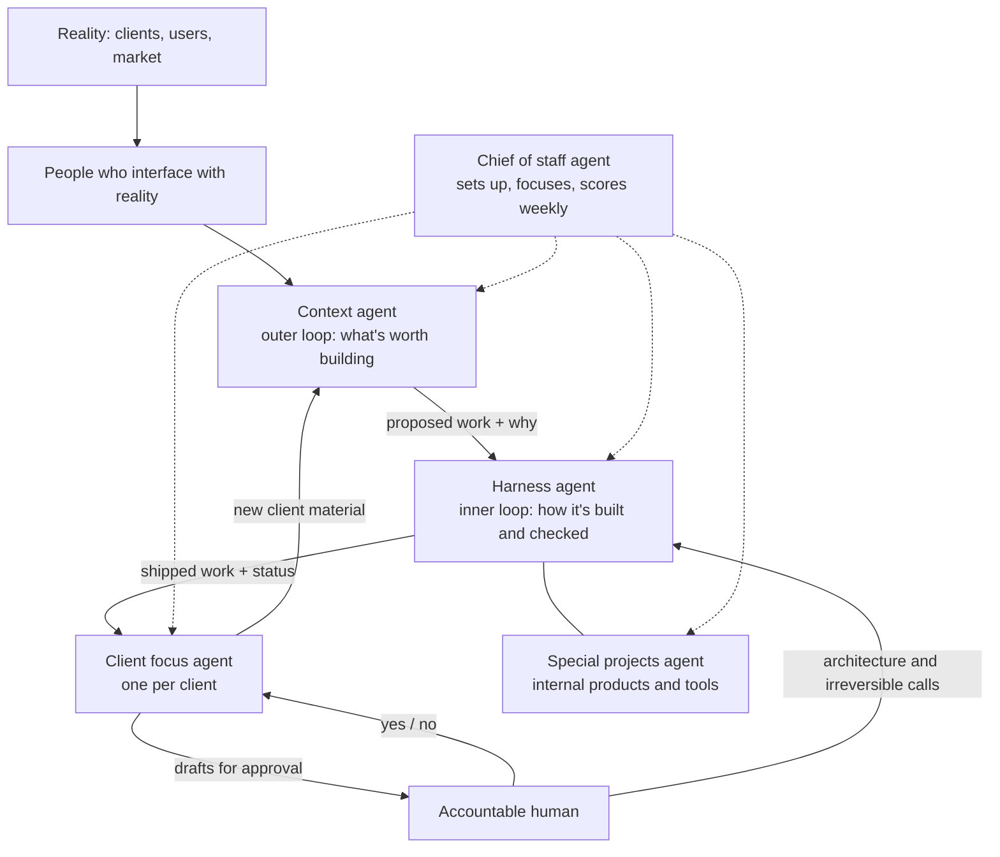

# datasaa-skills

The agent system I use to run AI-native product work, written out so you can read it and copy it. It's anonymized: roles, skills and rules, with no company, client or people names.

These are operating definitions (who owns what, which skill, which gate), not a runtime. Enforcement (scoped auth, budgets, kill switch, audit) lives in [agent-governance-mcp](https://github.com/rkwai/agent-governance-mcp).

## The idea: the middle of knowledge work has collapsed

A lot of knowledge work sits between understanding reality and producing an outcome. Someone turns meetings into notes. Someone pulls out what matters and compares it to work in motion. It becomes tickets, specs and plans. Ceremonies keep everyone aligned. Then people do the work, review it, report status and communicate the result.

None of that machinery was the purpose of the company. It existed to keep human work coordinated. Agents can now carry most of it: turn captured context into records, compare it with work in motion, run bounded loops, validate the output and report what changed.

Two human layers are left, and both matter more than before:
1. **People who interface with reality:** customers, users, markets, trust. They notice what changed.
2. **People who build the agents, loops and skills** that turn that reality into outcomes.

Longer version: [The Collapse of the Middle](https://www.aiagentmanagement.com/posts/the-collapse-of-the-middle).

## Why two agents sit at the center

If the middle is gone, two jobs have to be done well by something else:

- **Context**, the outer loop: what is true out there, and what's worth building? The **context agent** reads chat, meetings and email, keeps a sourced record, and proposes work.
- **Harness**, the inner loop: how does the work get built, checked and monitored? The **harness agent** puts AI at bounded steps in the workflow, runs loops that validate their own output, and generates status from the records.

Every other agent plugs into those two.



## The agents

| Agent | Owns | Decides alone | Needs a human yes |
|---|---|---|---|
| [Context](agents/context/AGENT.md) | The outer loop: what's true and worth building | Update the sourced record, propose work | Calling a claim validated without the client's words; contacting anyone outside |
| [Harness](agents/harness/AGENT.md) | The inner loop: build, validate, monitor | Branches, PRs, tests, loop retries, generated status | Architecture merges, irreversible changes, releases, changes to the agent setup |
| [Chief of staff](agents/chief-of-staff/AGENT.md) | The agent team | Route work, nudge agents, weekly score | Pushing a person; adding or re-permissioning agents |
| [Client focus](agents/client-focus/AGENT.md) | One client's delivery | Week plan, meeting scan, draft updates | Anything sent to the client; dates and scope |
| [Special projects](agents/special-projects/AGENT.md) | One internal product or tool | Build inside its own repo | Touching client systems; promoting to the shared kit |

## Rules we run by
Most of these exist because something broke first.
- **Agents push agents, never people.** Only the accountable human pushes a person for an answer or a deadline.
- **A quiet channel isn't a stalled agent** when the next move belongs to a person.
- **The client's words go on top.** A claim is validated only when the client said it. Our assumptions get their own section.
- **One client focus agent per client**, and it's the only one that raises that client's asks, so nothing gets asked twice.
- **Draft first, then approve** for anything external. **Sign-off before** architectural or irreversible changes.
- **Status is generated** from tickets, dates and decisions. No second tracker kept by hand.
- **Every item names an owner.** Items the human owns come with a recommendation.
- **Prove a pattern on one live client** before it goes into the shared kit.
- **Don't grow a skill catalog nobody uses.** Connect or retire unused skills before adding new ones.
- **Tweak agents that work. Don't redesign them.**

## Worked example
[`examples/meeting-to-status`](examples/meeting-to-status/): one fictional client meeting goes through intake, brief, context diff, loop and generated status. Each step is a real artifact you can open.

## Repo layout
```text
agents/<agent>/AGENT.md                 role, reads/writes, guardrails, hand-offs
agents/<agent>/skills/datasaa-*/SKILL.md the agent's skills
skills/shared/datasaa-*/SKILL.md        general product-engineering skills any agent can use
examples/                               worked examples
install.sh                              installs every datasaa-* skill
```

## Install
Skills use the standard `SKILL.md` format (a folder with YAML front matter), so Codex, Claude Code and similar agents can load them.
```bash
git clone https://github.com/rkwai/datasaa-skills && cd datasaa-skills
./install.sh global          # symlinks into ~/.agents/skills
./install.sh repo --target /path/to/repo --copy   # vendors into <repo>/.agents/skills
```
Run `./install.sh --help` for all options.

---
Rick Wong · rick@datasaa.com · [datasaa.com](https://datasaa.com)
